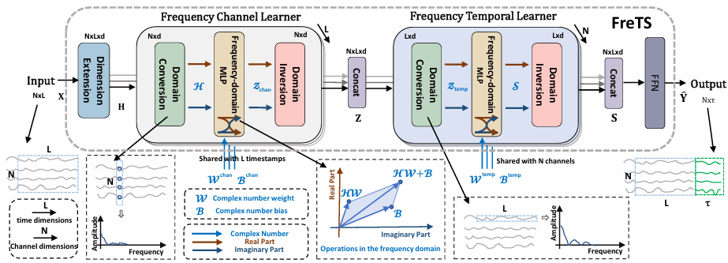
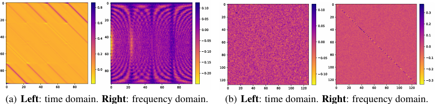
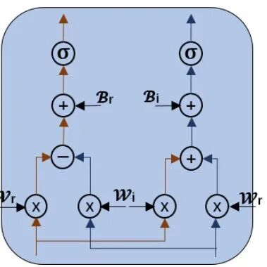
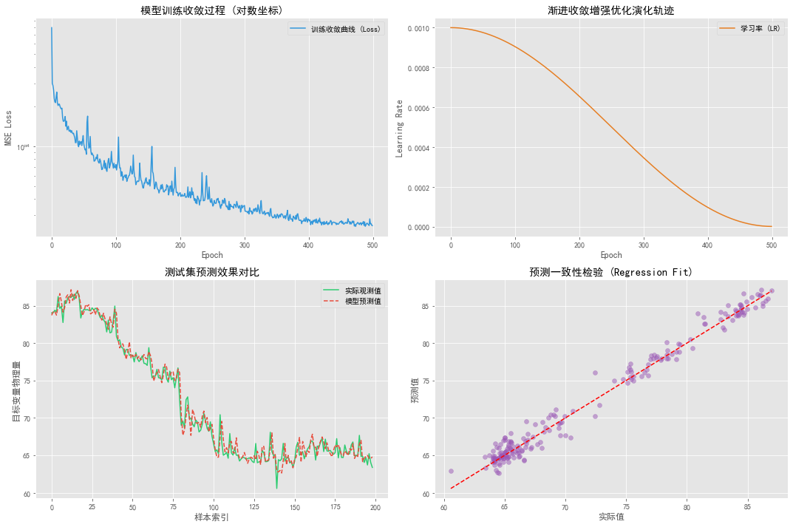

# Quick Write! Improvements to NeurIPS: Predictive Program Based on Reversible Frequency-Domain Cyclic Convolution (RFECC) for Wind, Photovoltaic, and Load Forecasting with Full Coverage! Even Beginners Can Get a First-Class Paper!

Run on platforms: Python 3.8 and above, PyTorch 1.12 and above, support CPU/GPU training.
Documentation interpretation:
References: Frequency-domain MLPs are More Effective Learners in Time Series Forecasting, authored by Kun Yi, Qi Zhang, Wei Fan, etc., published in NeurIPS 2023 (CCF-A class, one of the top AI conferences in the field).
Existing time series deep learning methods all model the signal in the time domain one point at a time, which inherently poses a natural information bottleneck: the models can only perceive local segments and cannot capture global dependencies spanning entire cycles. FreTS takes a different approach, mapping the time series signal to the frequency domain through discrete Fourier transform, and directly modeling the frequency components with a complex multilayer perceptron (FreMLP). The frequency domain possesses two intrinsic advantages that the time domain does not: global vision (the spectrum enables the MLP to simultaneously perceive the global periodic structure of the signal) and energy compression (the signal energy is highly concentrated in a few main frequency components). On the 13 standard benchmark datasets of NeurIPS 2023, FreTS achieves consistent performance leadership compared to all mainstream comparison methods, with an average MAE reduction of 9.4% and an average RMSE reduction of 11.6%.
Overall model architecture:
The overall architecture consists of two parallel learners:
1. The Frequency Channel Learner models the frequency dependencies between variables across channels in the channel dimension;
2. The Frequency Temporal Learner captures the internal frequency evolution patterns within each channel in the time dimension. After concatenating the two frequency domain representations, they are projected into multiple steps for prediction, without recursion or self-attention, and the computational graph is purely feedforward.
Innovative decomposition:
① Frequency-domain learning paradigm (fundamental innovation)
The following figure is Figure 1, which intuitively compares the weight learning results of time-domain and frequency-domain MLPs through heat maps:
In the left group (a), a global perspective comparison: The weights of the time-domain MLP are scattered and disordered, while those of the frequency-domain MLP exhibit a clear diagonal periodic structure, enabling the model to perceive the global correlation of the entire input. In the right group (b), a comparison of energy compression: The time-domain weights have high noise uniformly distributed, while the frequency-domain weights are highly concentrated at a few key diagonal positions, significantly reducing redundant computations.
2. Frequency-Domain Multilayer Perceptron (FreMLP) Filters
3. Adaptive Sparse Frequency Selection
Soft threshold shrinkage operator (Soft-Shrinkage) is introduced to sparse the spectrum coefficients:
This operator automatically sets zeros for frequencies below the threshold, retaining only the main frequencies that contribute significantly to prediction. It is particularly effective for strong periodic signals such as wind and solar power - the main frequencies corresponding to daily and half-daily cycles are prioritized to be retained, while high-frequency random noise (turbulence, cloud cover) is automatically suppressed.
4. RevIN Reversible Instance Normalization
Kim et al.'s (ICLR 2022) proposed reversible instance normalization is used to address non-stationary distribution offset issues. It involves normalizing and inverse normalizing the input sequence. During training, each sample is normalized independently, and during inference, the physical magnitude is precisely restored, directly outputting actual units (kW, MW), without additional post-processing.
Learning Rate Improvement: Gradient Ascent Enhanced Optimization Strategy
Dynamic adjustment of learning rates. The learning rate smoothly decays from an initial value to a lower bound, balancing early rapid convergence with later fine fitting, avoiding oscillations in the late stages of training.
Program Results
Data format: The first N columns are features, and the last column is power output
Results:
✅ Complete model code for reversible frequency domain circular convolution model (FreMLP complex frequency domain filter core + RevIN reversible instance normalization module implementation + gradient ascent enhanced optimization strategy)
✅ Wind power forecast data is included in the program, replacing the data file will switch to this version
✅ Four-figure visualization outputs: training convergence curve, learning rate evolution trajectory, prediction comparison curve, regression scatter plot
✅ Item evaluation indicators: MSE, MAE, MAPE, etc., results automatically printed and exported as CSV
Follow the editor for irregular updates of high-innovation, high-quality learning materials, articles, and code, to boost your research efforts!

## Images

<!-- PAYMENT_BLOCK -->

## Get this dataset

- Payment link (Stripe): [Buy now](https://buy.stripe.com/3cs8yP7sY87d0vu9AB)
- Payment QR code: 

<!-- /PAYMENT_BLOCK -->
